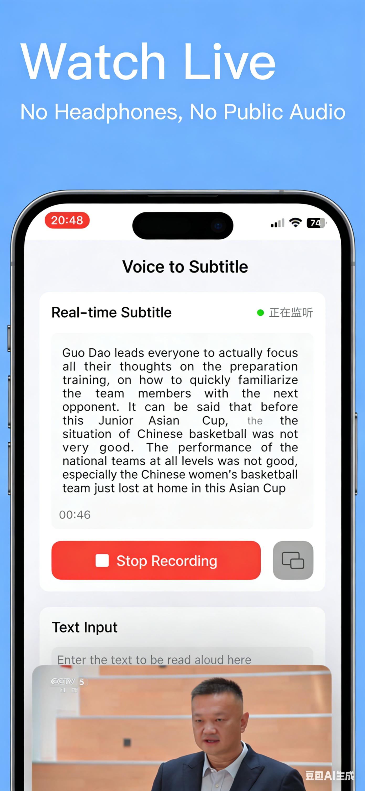
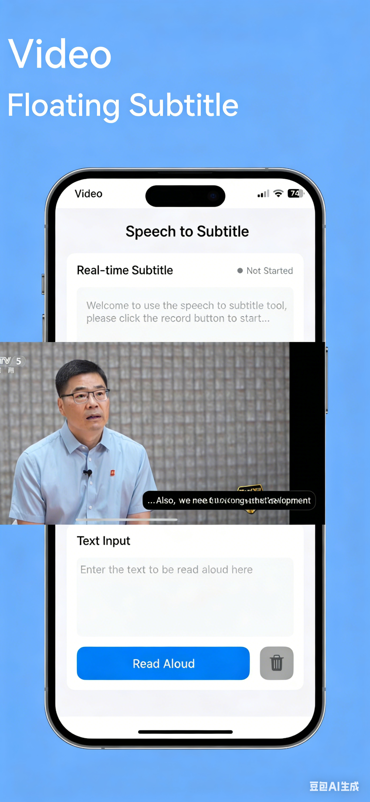
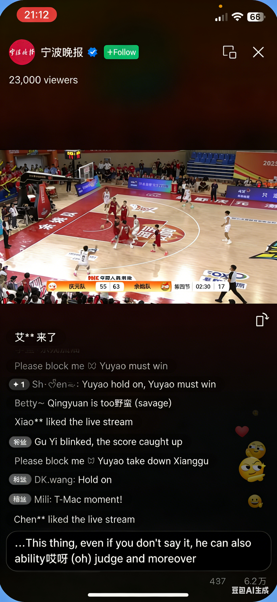
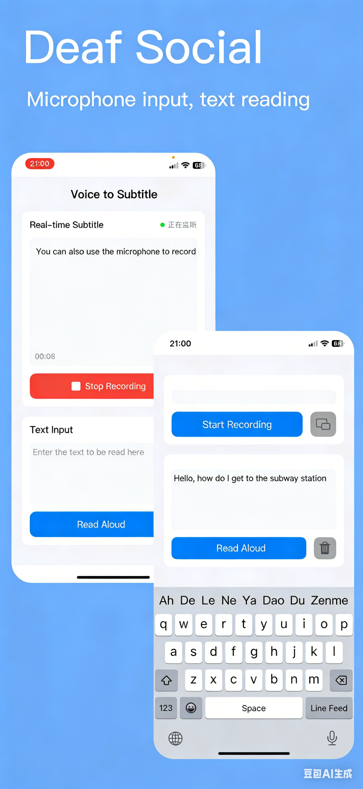
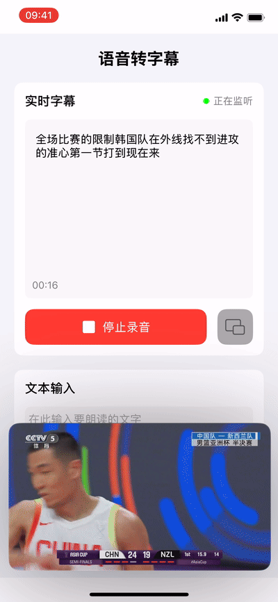
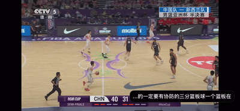
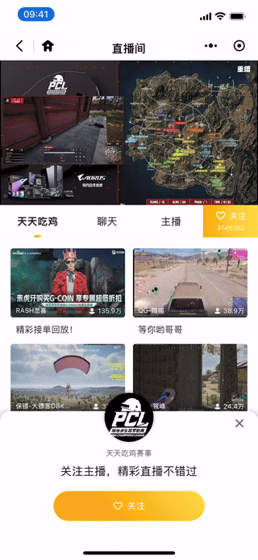

# FloatSub - Real-time Multilingual Speech-to-Subtitle for iOS

<p align="center">
  
</p>

## Overview

FloatSub is a real-time speech-to-subtitle iOS application designed to complement Apple's built-in Live Captions feature. While iOS 16 introduced Live Captions, it initially only supported English. FloatSub fills this gap by providing **Chinese (Simplified/Traditional) support** and also works with other languages using Apple's Speech framework.

Key features:
- Real-time audio-to-text transcription
- Picture-in-Picture (PiP) overlay for subtitles
- Support for multiple languages (primarily Chinese)
- Can capture both app audio and microphone input

## Features

### 🎯 Real-time Speech Recognition
- Utilizes Apple's SFSpeechRecognizer for accurate speech-to-text conversion
- Default language is Simplified Chinese (zh-CN)
- Easily configurable to support other languages

### 📱 Picture-in-Picture Mode
- Display subtitles in floating PiP window
- Works with any app in the background
- Adjustable subtitle display

### 🔊 Dual Audio Capture
- System/app audio capture via Broadcast Extension
- Microphone audio capture
- Both sources processed simultaneously

### 📝 Text-to-Speech
- Text input and read aloud feature
- Supports the same language as speech recognition

## Screenshots

<p align="center">
  
  
  
</p>

## Demo Videos

Here are three demo GIFs showing FloatSub in action:

1. **Basic functionality demonstration**:
   

2. **Picture-in-Picture mode in use**:
   

3. **Real-time subtitle generation**:
   

## Technical Stack

- **Swift & SwiftUI** - Modern iOS development
- **ReplayKit** - Audio broadcast extension
- **Speech Framework** - Speech recognition
- **AVFoundation** - Audio processing
- **Picture-in-Picture** - Floating window support

## Installation

### Prerequisites
- iOS 13.0 or later
- Xcode 14.0 or later
- CocoaPods

### Steps

1. Clone the repository:
```bash
git clone https://github.com/tangzhengyuan0602/FloatSub-OpenSource.git
cd FloatSub-OpenSource/FloatSub
```

2. Install dependencies:
```bash
pod install
```
The open-source version ships with **no third-party dependencies** in the Podfile;
the step above only sets up the empty CocoaPods workspace.

3. Open the workspace:
```bash
open FloatSub.xcworkspace
```

4. Configure your team and bundle identifiers in Xcode
5. Build and run the project

## Permissions

The app requires the following capabilities (configured in the target's
`Signing & Capabilities` / `Info.plist`):

- **Microphone** — live microphone input
- **Speech Recognition** — on-device/online ASR via `SFSpeechRecognizer`
- **Broadcast Extension (ReplayKit)** — capture system/app audio

> Note: This open-source build does **not** include any analytics or tracking SDK.
> Earlier internal builds bundled UMeng; that dependency has been removed here.

## Usage

### Starting the Subtitle Service
1. Launch the FloatSub app
2. Tap the "Start Recording" button
3. Select FloatSub from the broadcast options
4. Real-time subtitles will appear in the app

### Picture-in-Picture Mode
1. Tap the PiP button in the app
2. A floating subtitle window will appear
3. The window stays visible even when switching apps

### Text-to-Speech
1. Enter text in the text input field
2. Tap the "Read Aloud" button
3. The text will be spoken in the configured language

## Language Configuration

To change the recognition language, modify the `currentLanguage` property in `AudioRecognitionManager.swift`:

```swift
var currentLanguage: String = "zh-CN" // Change to your language code
```

Common language codes:
- `zh-CN` - Simplified Chinese
- `zh-TW` - Traditional Chinese
- `en-US` - English (US)
- `ja-JP` - Japanese
- `ko-KR` - Korean

## Project Structure

```
FloatSub/
├── FloatSub/
│   ├── FloatSub/              # Main app
│   │   ├── FloatSubApp.swift  # App entry point
│   │   ├── ContentView.swift  # Main UI
│   │   ├── AudioRecognitionManager.swift  # Speech recognition
│   │   └── UIPiPView.swift    # PiP implementation
│   ├── AudioCapture/           # Broadcast extension (ReplayKit)
│   └── app/                   # Multi-platform icon assets (iOS / Android / watch)
├── 海报/                       # Posters and screenshots
└── Podfile                    # CocoaPods manifest (no third-party pods)
```

## License

Released under the [MIT License](LICENSE).

## Acknowledgments

- Apple's Live Captions feature for inspiration
- [UIPiPView](https://github.com/uakihir0/UIPiPView) - Picture-in-Picture functionality library
- SwiftUI and modern iOS frameworks

---

**Note**: This app was developed to provide multilingual support for real-time captions on iOS, complementing Apple's initial English-only Live Captions introduced in iOS 16.
